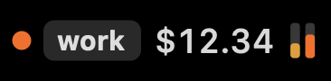
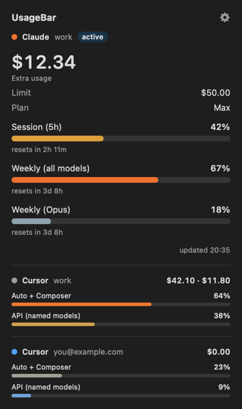
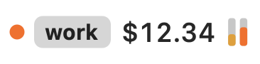
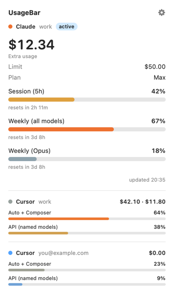

<div align="center">

# UsageBar

**See your Cursor and Claude usage at a glance: spend, limits and resets, right in the macOS menu bar or on the Windows desktop.**

[](https://github.com/yavuzceliker/usagebar/actions/workflows/build.yml)
[](https://github.com/yavuzceliker/usagebar/releases/latest)
[](LICENSE)


[](CONTRIBUTING.md)





</div>

UsageBar is a free, open-source **usage tracker for Cursor and Claude** (Claude Code, Claude Pro and Claude Max). It shows how close you are to your rate limits and how much on-demand spend you have racked up, before you hit a wall halfway through a task.

- 💸 **Cursor extra spend** for the current billing period (team and personal), plus *Auto + Composer* and *API* plan usage.
- ⏱️ **Claude Code limits**: 5-hour session %, weekly %, Opus/Sonnet weekly limits, extra-usage spend and a reset countdown for each.
- 👥 **Multiple accounts**: every Cursor and Claude login on the machine, in one place. The menu bar follows whichever account you used last.
- 🔴 **A dot that warns you**: blue → amber → orange → red as you approach the limit. It blinks faster the closer you get and flashes whenever usage goes up.
- 🔒 **Private by design**: no sign-up and no server of its own. It reuses the login the official apps already keep on your computer and only talks to Cursor's and Anthropic's own APIs.
- 🪶 **Tiny**: a native Swift app on macOS and one PowerShell script on Windows. No Electron, no runtime to install.

## Contents

- [Install](#install)
- [What it shows](#what-it-shows)
- [Multiple accounts](#multiple-accounts)
- [Privacy and how it works](#privacy-and-how-it-works)
- [FAQ](#faq)
- [Contributing](#contributing)

## Install

### macOS (13 Ventura or later)

**Download:** grab `UsageBar-macOS.zip` from the [latest release](https://github.com/yavuzceliker/usagebar/releases/latest), unzip it and move `UsageBar.app` to `Applications`. The app is not notarized yet, so open it the first time with **right-click → Open** (or run `xattr -dr com.apple.quarantine /Applications/UsageBar.app`).

**Or build from source** (needs the Xcode Command Line Tools, `xcode-select --install`):

```bash
git clone https://github.com/yavuzceliker/usagebar.git
cd usagebar/macos
./install.sh        # builds a universal app into ~/Applications and launches it
```

Then open the panel, click the gear and turn on **Launch at login**. To remove it, run `./uninstall.sh`.

### Windows (10 / 11)

1. Download `UsageBar-Windows.zip` from the [latest release](https://github.com/yavuzceliker/usagebar/releases/latest) (or the [`windows/`](windows/) folder) and unzip it.
2. Double-click `Kur.bat`. It copies the script to `%LOCALAPPDATA%\UsageBar`, adds it to Startup and starts it.
3. A small always-on-top strip appears at the top center of the screen. Drag it anywhere. **Left-click** opens the detail panel; **right-click** picks accounts, refreshes, opens the dashboards or quits.

Run `Kaldir.bat` to remove it. To check what it sees without any UI: `powershell -File UsageBar.ps1 -Probe`.

> The Windows version needs nothing else installed: it runs on the built-in Windows PowerShell 5.1, and `sqlite3.exe` (the official public-domain build from [sqlite.org](https://sqlite.org/download.html)) is bundled to read Cursor's login.

## What it shows

| | Menu bar / strip | Two tiny bars | Detail panel |
|---|---|---|---|
| **Cursor** | Extra (on-demand) spend this period. Team plans show `team · you`. | *Auto + Composer* and *API (named models)* usage of the included plan | Spend limit, plan usage in dollars, days until the billing cycle ends |
| **Claude** | Extra-usage spend if it is on, otherwise `session % · weekly %` | 5-hour session and weekly limits | Opus/Sonnet weekly limits, plan, and a reset countdown for each limit |

<details>
<summary>Light mode</summary>


<br>


</details>

## Multiple accounts

UsageBar finds every signed-in account on its own:

| | Default | Extra accounts |
|---|---|---|
| **Cursor** (macOS) | `~/Library/Application Support/Cursor` | any `~/.cursor-<name>` folder, e.g. from `cursor --user-data-dir ~/.cursor-work` |
| **Cursor** (Windows) | `%APPDATA%\Cursor` | any `%USERPROFILE%\.cursor-<name>` folder |
| **Claude Code** (macOS) | `~/.claude` | any `~/.claude-<name>` folder, e.g. from `CLAUDE_CONFIG_DIR=~/.claude-work claude` |
| **Claude Code** (Windows) | `%USERPROFILE%\.claude` | any `%USERPROFILE%\.claude-<name>` folder |

- **Menu bar**: the account that sent the latest request, labeled with its folder name (`work`, `personal`, …) when more than one is tracked. For Claude, "latest request" comes from Claude Code's transcript files. For Cursor, it is the moment its spend goes up.
- **Panel**: every account, most recently used first. The active one is expanded.
- **Settings** (gear on macOS, right-click on Windows): tick which accounts to show.

A handy way to keep several Claude logins side by side is one alias per account (add these to `~/.zshrc`):

```bash
alias claude-work='CLAUDE_CONFIG_DIR=~/.claude-work claude'
alias claude-side='CLAUDE_CONFIG_DIR=~/.claude-side claude'
```

Run each alias once and `/login` with that account. UsageBar picks it up within 5 minutes, or right away if you choose **Refresh**.

## Privacy and how it works

UsageBar has no account of its own and stores no tokens. Each time it refreshes, it reads the session that the official apps already keep on your computer:

| Source | Where the token is read from | API called |
|---|---|---|
| Cursor | `<user data dir>/User/globalStorage/state.vscdb` (opened read-only) | `api2.cursor.sh` (`DashboardService/GetCurrentPeriodUsage`) |
| Claude | macOS Keychain item `Claude Code-credentials[-<hash of config dir>]`, or `<config dir>/.credentials.json` | `api.anthropic.com/api/oauth/usage` |

- Tokens are never written to disk, logged, or sent anywhere other than the vendor's own API.
- UsageBar never refreshes the Claude token, so your Claude Code login is never touched. If it expires, open Claude Code once.
- Polling: Cursor every 15 s, Claude every 60 s (sooner right after you use it), plus a refresh when the Mac wakes from sleep. If Anthropic answers with a rate limit, UsageBar backs off (2 → 4 → 8 … up to 30 min).
- The only settings it keeps are which accounts you hid and when each was last used (macOS `UserDefaults`, Windows `%LOCALAPPDATA%\UsageBar\settings.json`).

> [!NOTE]
> Both endpoints are undocumented, internal APIs used by the vendors' own dashboards. They may change without notice. If the numbers stop showing up, please [open an issue](https://github.com/yavuzceliker/usagebar/issues/new/choose).

## FAQ

**Does it work with Claude Pro / Max subscriptions?**
Yes. It reads the same usage limits you see at [claude.ai/settings/usage](https://claude.ai/settings/usage) for any account signed in to Claude Code.

**Does it work with Cursor team plans?**
Yes. Team plans show the pooled team spend and your own share (`team · you`).

**I logged in with `/login` and the old account disappeared.**
Claude Code keeps one login per config folder, so `/login` replaces it. Use a separate folder for each account (see [Multiple accounts](#multiple-accounts)).

**Does it send my data anywhere?**
No. There is no UsageBar server, analytics or telemetry. See [Privacy and how it works](#privacy-and-how-it-works).

**What language is the UI in?**
It follows the system language: Turkish if your computer is set to Turkish, English otherwise. Translations are welcome.

## Contributing

Bug reports, ideas and pull requests are very welcome. Adding another provider (GitHub Copilot, Windsurf, OpenAI Codex, …) or another language is a great first contribution. See [CONTRIBUTING.md](CONTRIBUTING.md) for the project layout and how to test.

```bash
cd macos
swift build                                   # debug build
./build.sh                                    # release .app in macos/build/
build/UsageBar.app/Contents/MacOS/UsageBar --snapshot ../docs --demo   # regenerate the screenshots with fake data
```

If UsageBar saves you from a surprise bill, a ⭐ helps other people find it.

## License

[MIT](LICENSE). UsageBar is an independent project and is not affiliated with, endorsed by or sponsored by Anysphere (Cursor) or Anthropic (Claude). All product names are trademarks of their respective owners.
